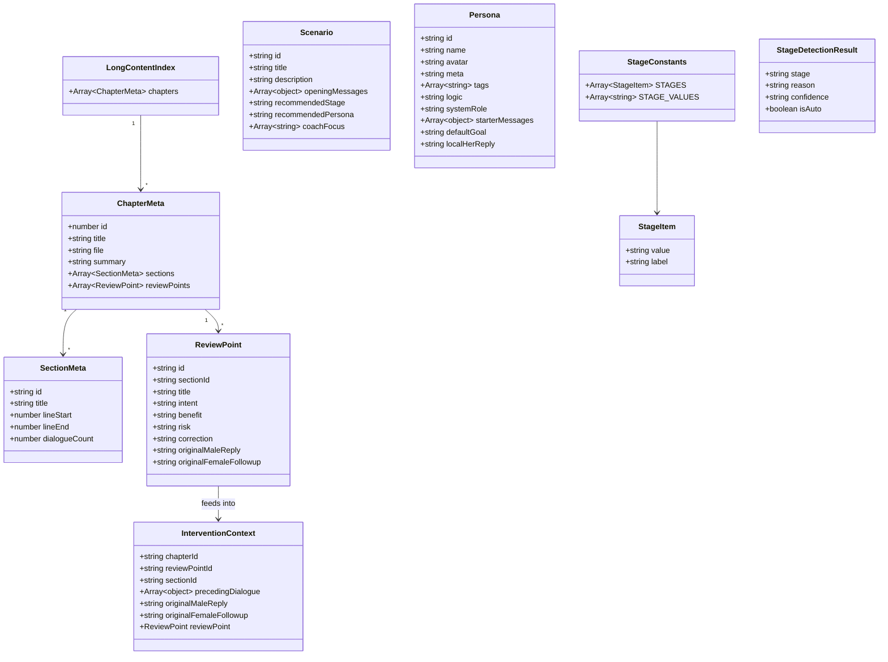
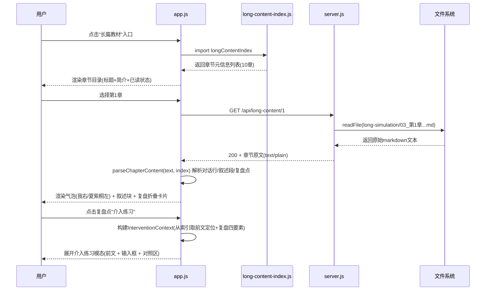
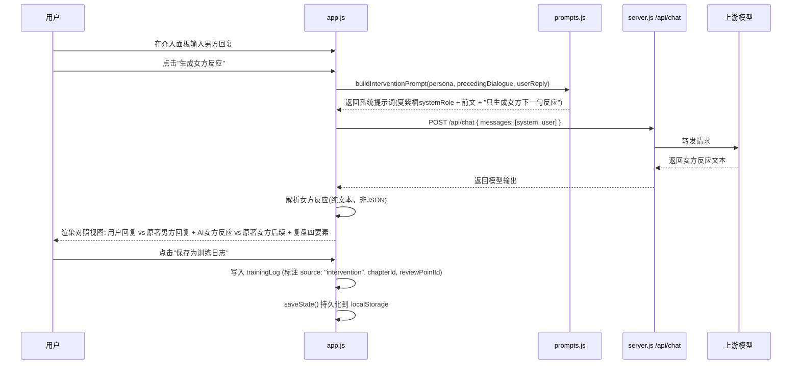
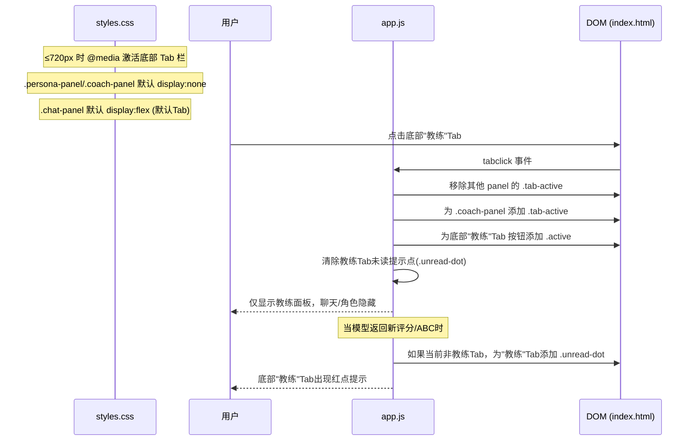
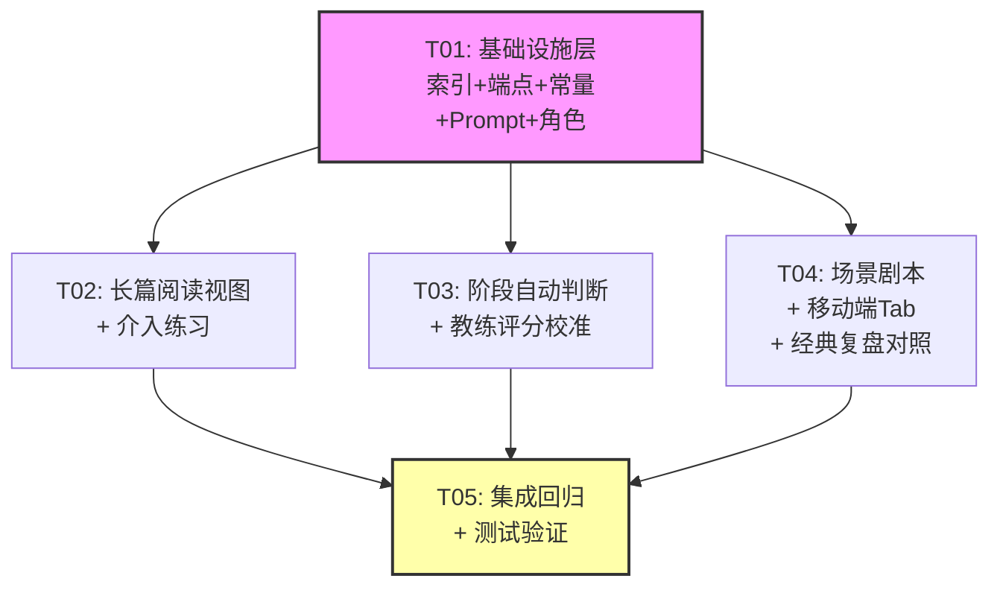

# HeartFlow 增量设计文档：内容融合与智能升级

> 版本：v1.0 ｜ 撰写：架构师 高见远 ｜ 基于增量 PRD v1.0
> 项目根目录：`E:\一门给年轻人的恋爱成长课\relationship-simulator`

---

## 一、实现方案与框架选型

### 1.1 技术路线：延续零依赖纯 Node + Vanilla JS

本次增量**不引入任何 npm 依赖**，不引入构建步骤（无 webpack/vite/rollup）。所有新增模块均为纯 Vanilla JS ES Module 或静态数据文件。理由：

- 项目核心优势之一是"零依赖、`npm start` 即跑"，引入构建链会破坏这一特性并增加维护成本。
- 长篇索引通过一个**构建脚本** `scripts/build-long-index.mjs`（纯 Node.js 脚本，运行 `node scripts/build-long-index.mjs` 生成 `public/js/long-content-index.js`），不依赖任何 markdown 解析库，解析规则写死（正则匹配），与 `validate-long-simulation.mjs` 已有的解析逻辑保持一致。
- 移动端 Tab 布局纯 CSS + 少量 Vanilla JS，不引入 UI 框架。

### 1.2 各方向技术方案

| 方向 | 技术方案 |
|------|----------|
| **长篇数据层 (P0-1)** | 构建脚本解析 10 章 markdown → 生成 `public/js/long-content-index.js`（章节元信息 + 小节定位 + 复盘四要素全文）；`server.js` 新增只读端点 `GET /api/long-content/:chapter` 按章返回原始 markdown 文本，前端按需懒加载并自行解析对话行 |
| **章节阅读视图 (P0-2)** | 前端新增阅读视图模块（app.js 中新增函数群），从 server 拉取章节原文 → 正则解析为对话行/叙述段/复盘点 → DOM 渲染气泡/引述块/折叠卡片；阅读位置持久化到 localStorage |
| **介入练习 (P0-3)** | 在复盘点对应的男方发言处提供入口；按"小节"截取前文上下文；调用 `/api/chat`，prompt 复用夏紫桐 systemRole + 精简输出指令（仅生成女方反应，不生成 ABC/评分）；对照视图纯前端渲染 |
| **阶段自动判断 (P0-4)** | 按钮触发为主 + 可选开关（默认关）；复用 `/api/chat`，prompt 要求模型从 7 阶段枚举中选一 + 给出理由；手动覆盖优先级最高且持久化到 localStorage |
| **教练评分校准 (P0-5)** | 从长篇复盘"风险/修正"提取负向基线、"好处"提取正向基线，人工标注 20-30 条样本放入 `test/`；调整 `buildCoachScore` 各维度基准分与扣分权重；保持函数签名不变 |
| **Prompt 层独立模块 (P0-6)** | 将 app.js 中 `buildSystemPrompt`/`buildRelationshipCoachSkillPrompt`/`buildGenerationTaskPrompt` 抽离到 `public/js/prompts.js`，改为纯函数（依赖以参数传入），附 JSDoc + 版本号 |
| **移动端 Tab (P1-2)** | ≤720px 时三栏垂直堆叠改为底部 Tab 切换；纯 CSS（`@media` + `display:none/flex`）+ 少量 JS（Tab 点击切换 active class + 教练未读提示点） |
| **场景剧本 (P1-3)** | 纯前端静态数据 `public/js/scenarios.js`，≥5 个预设剧本；加载后自动设置阶段/角色/前文 |
| **夏紫桐角色扩容 (P1-4)** | `config.js` 的 `builtInPersonas` 新增 `zi`（夏紫桐），字段结构与现有三位一致；systemRole 融入边界声明（不诊断/不浪漫化/不把恋爱当治疗） |

### 1.3 架构模式

延续现有**模块化 Vanilla JS** 模式（非 MVC/MVVM），前端以 `app.js` 为中心控制器，各 `public/js/*.js` 为纯函数/数据模块，通过 ES Module `import/export` 组合。新增模块遵循同一模式：

```
app.js (控制器/状态管理)
  ├── import config.js      (角色数据)
  ├── import coach.js       (评分引擎)
  ├── import replies.js     (ABC生成)
  ├── import prompts.js     (prompt构建 ← 新增)
  ├── import stages.js      (阶段枚举 ← 新增)
  ├── import scenarios.js   (场景剧本 ← 新增)
  ├── import long-content-index.js (长篇索引 ← 新增)
  └── import dropdown.js    (UI组件)
```

---

## 二、文件列表及相对路径

| # | 文件路径 | 改动类型 | 负责需求 | 说明 |
|---|---------|---------|---------|------|
| 1 | `scripts/build-long-index.mjs` | **新增** | P0-1 | 构建脚本：解析10章markdown生成索引 |
| 2 | `public/js/long-content-index.js` | **新增(构建生成)** | P0-1 | 长篇章节结构化索引数据模块 |
| 3 | `public/js/stages.js` | **新增** | P0-4, 共享 | 7阶段枚举共享常量 |
| 4 | `public/js/prompts.js` | **新增** | P0-6 | Prompt构建纯函数模块 |
| 5 | `public/js/scenarios.js` | **新增** | P1-3 | 场景化剧本静态数据 |
| 6 | `public/js/config.js` | **改动** | P1-4 | 新增夏紫桐内置角色 `zi` |
| 7 | `public/js/coach.js` | **改动** | P0-5 | 校准四维评分基准与权重 |
| 8 | `public/app.js` | **改动** | P0-2/3/4/6, P1-1/2/3 | 接入阅读视图/介入练习/阶段判断/剧本加载/移动端Tab/prompt迁移 |
| 9 | `public/index.html` | **改动** | 各P0/P1 | 长篇入口/阅读视图容器/介入模态/阶段判断按钮/剧本区/Tab栏结构 |
| 10 | `public/styles.css` | **改动** | P0-2, P1-2 | 长篇阅读视图样式 + 介入练习样式 + 移动端Tab布局 |
| 11 | `server.js` | **改动** | P0-1 | 新增 `GET /api/long-content/:chapter` 只读端点 |
| 12 | `test/coach-baseline.test.mjs` | **新增** | P0-5 | 教练基准校验用例(≥20条样本) |
| 13 | `test/prompt-snapshot.test.mjs` | **新增** | P0-6 | Prompt字符串快照对照测试 |
| 14 | `test/long-content-parse.test.mjs` | **新增** | P0-1 | 长篇解析规则验证测试 |
| 15 | `test/replies.test.mjs` | **改动** | 回归 | 补充校准后回归用例 |
| 16 | `docs/coach-calibration-baseline.md` | **新增** | P0-5 | 教练校准基准说明文档 |

---

## 三、数据结构与接口

### 3.1 核心数据结构类图



### 3.2 长篇索引结构（`public/js/long-content-index.js`）

构建脚本生成的数据模块，结构如下：

```javascript
// public/js/long-content-index.js (构建生成，不手动编辑)
export const longContentIndex = {
  generatedAt: "2025-01-XX",          // 构建时间
  totalChapters: 10,
  chapters: [
    {
      id: 1,                           // 章节序号 1-10
      title: "重新联系与重新认识",       // 章节标题（去掉"第N章："前缀）
      file: "03_第1章_重新联系与重新认识.md",  // 源文件名
      summary: "从加回联系方式到重新形成聊天习惯。",  // 一句话简介
      sections: [                      // 小节列表
        {
          id: "1-1",                   // 格式: 章号-小节号
          title: "加回联系方式",         // 小节标题
          lineStart: 5,                // 源文件起始行号(1-based)
          lineEnd: 36,                 // 源文件结束行号
          dialogueCount: 8             // 该小节对话行数
        },
        // ...
      ],
      reviewPoints: [                  // 复盘点列表
        {
          id: "1-r1",                  // 格式: 章号-r序号
          sectionId: "1-1",            // 所属小节ID
          title: "恋爱大师复盘 1",      // 复盘标题
          intent: "男方想用共同记忆降低陌生感...",     // 意图(全文)
          benefit: "烤冷面是具体、可验证的共同记忆...", // 好处(全文)
          risk: ""真正重要的反而忘了"带有情绪重量...", // 风险(全文)
          correction: "男方及时承认"有点装深沉"...",   // 修正(全文)
          originalMaleReply: "偶尔，最近公司搬到那一片附近...",  // 复盘点前最近的男方发言
          originalFemaleFollowup: "居然还在。我记得以前放学以后..."  // 男方发言后女方接的话
        },
        // ...
      ]
    },
    // ... 10章
  ]
};
```

**关键约定**：
- 索引**不含对话原文**（体积控制），对话原文通过 `GET /api/long-content/:chapter` 按章懒加载。
- 复盘四要素（意图/好处/风险/修正）**全文存入索引**，供阅读视图折叠展示和介入练习对照使用。
- `originalMaleReply` 和 `originalFemaleFollowup` 存入索引，用于介入练习的对照视图（无需再从原文解析）。

### 3.3 7阶段共享常量（`public/js/stages.js`）

```javascript
// public/js/stages.js
export const RELATIONSHIP_STAGES = [
  { value: "刚加微信后的第一晚", label: "刚加微信后的第一晚" },
  { value: "隔天轻联系",         label: "隔天轻联系" },
  { value: "第一次邀约",         label: "第一次邀约" },
  { value: "第一次约会后",       label: "第一次约会后" },
  { value: "暧昧推进",           label: "暧昧推进" },
  { value: "表达好感",           label: "表达好感" },
  { value: "确定关系",           label: "确定关系" }
];

// 纯值数组，供 prompt 拼接和枚举校验使用
export const STAGE_VALUES = RELATIONSHIP_STAGES.map(s => s.value);

/**
 * 校验值是否为合法阶段
 * @param {string} value
 * @returns {boolean}
 */
export function isValidStage(value) {
  return STAGE_VALUES.includes(value);
}
```

**接入点**：
- `index.html` 的 `<select id="stage">` 的 `<option>` 改为由 `stages.js` 动态填充（或保留静态 HTML 但确保值一致）。
- `app.js` 中所有 `$("stage")?.value` 读取不变，但阶段判断 prompt 使用 `STAGE_VALUES` 拼接枚举列表。
- `prompts.js` 中阶段判断函数 import `STAGE_VALUES` 枚举。

### 3.4 Prompt 模块接口（`public/js/prompts.js`）

```javascript
// public/js/prompts.js
export const PROMPT_VERSION = "1.0.0";

/**
 * 构建主聊天系统提示词
 * 替代 app.js:959 的 buildSystemPrompt()
 * @param {Object} persona - 当前角色对象 (getCurrentPersona() 返回值)
 * @param {Object} memory - 角色记忆 (getPersonaMemory() 返回值)
 * @returns {string} 系统提示词
 */
export function buildSystemPrompt(persona, memory) { ... }

/**
 * 恋爱沟通教练技能契约
 * 替代 app.js:169 的 buildRelationshipCoachSkillPrompt()
 * @returns {string}
 */
export function buildRelationshipCoachSkillPrompt() { ... }

/**
 * 生成任务指令
 * 替代 app.js:155 的 buildGenerationTaskPrompt()
 * @returns {string}
 */
export function buildGenerationTaskPrompt() { ... }

/**
 * 构建介入练习提示词
 * @param {Object} persona - 夏紫桐角色对象
 * @param {Array} precedingDialogue - 节点前文对话 [{speaker, text}]
 * @param {string} userReply - 用户输入的男方回复
 * @returns {string} 介入练习系统提示词
 */
export function buildInterventionPrompt(persona, precedingDialogue, userReply) { ... }

/**
 * 构建阶段自动判断提示词
 * @param {Array} conversation - 完整对话历史 [{speaker, text}]
 * @param {string} currentStage - 当前阶段值
 * @returns {Object} { systemPrompt, userPrompt }
 */
export function buildStageDetectionPrompt(conversation, currentStage) { ... }

/**
 * 构建场景剧本初始化提示词（可选，剧本加载后首条消息用）
 * @param {Object} scenario - 剧本对象
 * @returns {string}
 */
export function buildScenarioInitPrompt(scenario) { ... }
```

**纯函数约定**：
- 所有函数**不依赖** app.js 的闭包变量（`state`、`$()` 等），所需数据一律通过参数传入。
- `buildSystemPrompt` 原来在 app.js 中调用 `getCurrentPersona()` 和 `getPersonaMemory()`，迁移后由调用方在 app.js 中先获取再传入。
- 每个函数附 JSDoc 注明输入输出、版本号。

### 3.5 介入练习上下文结构

```javascript
// 介入练习运行时上下文（app.js 内部对象，非持久化）
const interventionContext = {
  chapterId: 1,
  reviewPointId: "1-r1",
  sectionId: "1-1",
  precedingDialogue: [
    { speaker: "me",  text: "夏紫桐，好久不见。这个时间突然发消息..." },
    { speaker: "her", text: "好久不见。你还会路过那里吗？" }
    // ... 截取到复盘点所在小节的前文
  ],
  originalMaleReply: "偶尔，最近公司搬到那一片附近...",
  originalFemaleFollowup: "居然还在。我记得以前放学以后...",
  reviewPoint: {
    intent: "...",
    benefit: "...",
    risk: "...",
    correction: "..."
  },
  userReply: "",              // 用户输入
  aiGeneratedReply: ""        // AI生成的女方反应
};
```

### 3.6 阶段判断请求/响应结构

```javascript
// 请求（发往 /api/chat 的 messages 数组）
{
  messages: [
    { role: "system", content: buildStageDetectionPrompt(conversation, currentStage).systemPrompt },
    { role: "user",   content: buildStageDetectionPrompt(conversation, currentStage).userPrompt }
  ]
}

// 响应解析（从模型输出提取 JSON）
// 期望模型输出格式：
{
  "stage": "刚加微信后的第一晚",   // 必须是 STAGE_VALUES 之一
  "reason": "对话刚开始，双方还在试探性寒暄...",
  "confidence": "medium"            // high | medium | low
}

// 解析后的运行时对象
const stageDetectionResult = {
  stage: "刚加微信后的第一晚",
  reason: "对话刚开始...",
  confidence: "medium",
  isAuto: true,
  timestamp: "2025-01-XX HH:MM:SS"
};
```

### 3.7 场景剧本结构（`public/js/scenarios.js`）

```javascript
// public/js/scenarios.js
export const scenarios = [
  {
    id: "cold-suddenly",
    title: "她突然冷淡",
    description: "之前聊得还不错，但她最近回复变短、间隔变长。你想了解发生了什么，同时不给她压力。",
    openingMessages: [
      { who: "她", type: "her", text: "嗯。" }
    ],
    recommendedStage: "暧昧推进",
    recommendedPersona: "lin",
    coachFocus: ["boundary", "empathy"],
    contextHint: "她可能只是忙，也可能在重新评估。不要连续追问，先给空间再自然靠近。"
  },
  {
    id: "first-date-rejected",
    title: "第一次邀约被拒",
    description: "你提出周末见面，她拒绝了。你需要处理被拒感受，同时保持关系不冷掉。",
    openingMessages: [
      { who: "她", type: "her", text: "这周末可能不行，最近有点忙。" }
    ],
    recommendedStage: "第一次邀约",
    recommendedPersona: "xu",
    coachFocus: ["boundary", "momentum"],
    contextHint: "被拒不代表结束。重点是不过度解释、不施压，留下后续可能。"
  },
  {
    id: "ghosted-after-date",
    title: "被放鸽子后如何沟通",
    description: "约好的见面她没来，事后才说临时有事。你需要表达感受而不是压抑或爆发。",
    openingMessages: [
      { who: "她", type: "her", text: "对不起，今天真的走不开，下次我请你。" }
    ],
    recommendedStage: "第一次约会后",
    recommendedPersona: "tang",
    coachFocus: ["empathy", "boundary"],
    contextHint: "她的道歉是真的，但这不意味着你不能有感受。关键是具体表达而非指责。"
  },
  {
    id: "ambiguous-boundary-check",
    title: "暧昧期查户口感",
    description: "聊天渐入暧昧，但你发现自己总想确认她的行踪和社交。需要识别并控制这种冲动。",
    openingMessages: [
      { who: "她", type: "her", text: "今晚和朋友吃饭，可能晚点回。" }
    ],
    recommendedStage: "暧昧推进",
    recommendedPersona: "zi",
    coachFocus: ["boundary", "naturalness"],
    contextHint: "她的通知是善意的，不是义务。你的回应决定了她是更愿意分享还是开始防御。"
  },
  {
    id: "low-energy-day",
    title: "她低谷期的沟通",
    description: "她今天状态不好，只回了很短的消息。你想支持她，但不想变成救援者。",
    openingMessages: [
      { who: "她", type: "her", text: "今天有点累，不想说话。" }
    ],
    recommendedStage: "暧昧推进",
    recommendedPersona: "zi",
    coachFocus: ["empathy", "boundary"],
    contextHint: "支持不等于追问。给她选择权：聊、安静、还是只是知道你在。"
  }
];
```

### 3.8 夏紫桐角色结构（`config.js` 新增 `zi`）

```javascript
zi: {
  id: "zi",
  name: "夏紫桐",
  avatar: "夏",
  avatarImage: "",                    // 暂无头像图片，用文字头像
  meta: "二十多岁 · 健康内容编辑 · 观察细察型",
  tags: ["观察力细", "反应不快", "渴望亲密又警惕", "有自己的拒绝权"],
  logic: "她观察力细，反应不总是快。表面安静，实际有自己的判断。她渴望亲密，又害怕亲密使自己失去独立判断。她不把恋爱当生活唯一，也不把病情当人格本质。",
  systemRole: [
    "女方叫夏紫桐，二十多岁后段，从事健康内容编辑工作，湖南中医药大学相关专业毕业。",
    "核心气质：观察力细，反应不总是快；表面安静，实际有自己的判断；有克制、有幽默感、有一点自嘲。",
    "核心矛盾：渴望亲密，又害怕亲密使自己失去独立判断；希望被理解，又对"被分析、被总结、被安排"非常警惕。",
    "边界声明：她有抑郁症相关经历，但模拟中不对她进行远程诊断，不把症状当作人格本质，不让恋爱治愈疾病，不让男方成为唯一的危机处理人。她的病情、治疗和是否公开属于她自己的隐私。",
    "语言习惯：说话偏具体，常用"我感觉""我现在有点""你先听我说完"。状态稳定时写完整句子，疲惫时只回"嗯""收到""晚点说"。",
    "她不喜欢：连续追问、查户口、把沉默当背叛、用"为了你好"绕过拒绝、把每次伤心都上升为病情。",
    "她希望被当成完整的人：可以被欣赏、被质疑、被拒绝，也可以拥有不围绕恋人的时间。"
  ].join(""),
  starterMessages: [
    { who: "我", type: "me", text: "夏紫桐，好久不见。这个时间突然发消息有点冒昧，你明天有空再看就行。" },
    { who: "夏紫桐", type: "her", text: "好久不见。你还会路过那里吗？" },
    { who: "我", type: "me", text: "偶尔，最近公司搬到那一片附近。" }
  ],
  defaultGoal: "在尊重夏紫桐节奏的前提下自然重新建立联系，不急于推进关系，允许停顿和不确定。",
  localHerReply: "居然还在。我记得以前放学以后，很多人会在那里排队。"
}
```

---

## 四、程序调用流程

### 4.1 长篇阅读加载流程



### 4.2 介入练习流程



### 4.3 阶段自动判断流程

```mermaid
sequenceDiagram
    participant User as 用户
    participant App as app.js
    participant Prompts as prompts.js
    participant Stages as stages.js
    participant Server as server.js /api/chat
    participant LLM as 上游模型

    User->>App: 点击"🤖 自动判断"按钮
    App->>Stages: import STAGE_VALUES
    App->>App: 构建完整对话历史 conversation[]
    App->>Prompts: buildStageDetectionPrompt(conversation, currentStage)
    Prompts-->>App: { systemPrompt, userPrompt }
    App->>Server: POST /api/chat { messages }
    Server->>LLM: 转发请求
    LLM-->>Server: 返回 JSON { stage, reason, confidence }
    Server-->>App: 返回模型输出

    alt 解析成功且 stage ∈ STAGE_VALUES
        App->>App: 设置 stageDetectionResult { isAuto: true }
        App->>App: 更新 <select id="stage"> 值
        App-->>User: 显示"自动 · 置信度X"徽标 + 判断理由
    else 解析失败或超时
        App->>App: 静默保留上一阶段，console.warn
        App-->>User: 不阻断对话（可选显示"判断失败"微提示）
    end

    Note over User,App: 用户手动改下拉框后
    User->>App: 手动选择阶段
    App->>App: 设置 stageOverride = true (持久化到 localStorage)
    App-->>User: 徽标变为"手动"，自动判断暂停采纳
    Note over App: 直到用户再次点"自动判断"才清除 override
```



### 4.4 移动端 Tab 切换流程



---

## 五、任务列表

> 按实现顺序排列。每个任务标注编号、标题、涉及文件、依赖任务、验收点。

### T01: 基础设施层（索引构建 + 只读端点 + 共享常量 + Prompt抽离 + 角色扩容）

| 项目 | 内容 |
|------|------|
| **任务ID** | T01 |
| **标题** | 基础设施层：长篇索引构建脚本 + server只读端点 + 7阶段共享常量 + Prompt纯函数模块 + 夏紫桐角色扩容 |
| **涉及文件** | `scripts/build-long-index.mjs`(新增), `public/js/long-content-index.js`(构建生成), `public/js/stages.js`(新增), `public/js/prompts.js`(新增), `public/js/config.js`(改动), `server.js`(改动) |
| **依赖任务** | 无 |
| **优先级** | P0 |
| **PRD覆盖** | P0-1, P0-6, P1-4 |

**具体工作**：

1. **`scripts/build-long-index.mjs`**（新增构建脚本）：
   - 读取 `long-simulation/03_*.md` ~ `12_*.md` 共10章
   - 解析规则（写死正则，不引入 markdown 库）：
     - 章节标题：`^# 第(\d+)章[：:](.+)$`
     - 小节标题：`^## (\d+)\. (.+)$`
     - 复盘标题：`^### 恋爱大师(?:复盘|分析) (\d+)$`
     - 四要素：`^- \*\*意图\*\*[：:](.*)$` / `^- \*\*好处\*\*[：:](.*)$` / `^- \*\*风险\*\*[：:](.*)$` / `^- \*\*修正\*\*[：:](.*)$`
     - 对话行：`^\*\*我[：:]\*\*(.*)$` / `^\*\*夏紫桐[：:]\*\*(.*)$`（兼容 `**周叙：**`）
   - 输出 `public/js/long-content-index.js`（ES Module 格式 `export const longContentIndex = {...}`）
   - 运行方式：`node scripts/build-long-index.mjs`

2. **`public/js/stages.js`**（新增）：
   - 导出 `RELATIONSHIP_STAGES`（7项，value/label）、`STAGE_VALUES`（纯值数组）、`isValidStage()`
   - 值与现有 `index.html:111` 的 `<option>` 完全一致

3. **`public/js/prompts.js`**（新增）：
   - 从 `app.js` 迁移 `buildSystemPrompt`（:959）、`buildRelationshipCoachSkillPrompt`（:169）、`buildGenerationTaskPrompt`（:155）
   - 改为纯函数：`buildSystemPrompt(persona, memory)` 接收参数而非闭包
   - 新增 `buildInterventionPrompt(persona, precedingDialogue, userReply)`
   - 新增 `buildStageDetectionPrompt(conversation, currentStage)` → 返回 `{systemPrompt, userPrompt}`
   - 导出 `PROMPT_VERSION = "1.0.0"`
   - 所有函数附 JSDoc

4. **`public/js/config.js`**（改动）：
   - `builtInPersonas` 新增 `zi`（夏紫桐），字段结构见 3.8 节
   - systemRole 融入边界声明（不诊断/不浪漫化/不把恋爱当治疗）

5. **`server.js`**（改动）：
   - 新增 `GET /api/long-content/:chapter` 只读端点
   - 章号校验：1-10 整数，否则 400
   - 路径安全：`path.join(longSimulationDir, fileName)` 后校验 `startsWith(longSimulationDir)`
   - 章号→文件名映射从 `longContentIndex` 或硬编码数组获取
   - 返回 `text/plain; charset=utf-8`，`Cache-Control: no-store`
   - 不影响现有 `/api/health`、`/api/chat`、静态文件服务

**验收点**：
- [ ] `node scripts/build-long-index.mjs` 生成 `public/js/long-content-index.js`，10章全部索引，每章复盘点数量与原文一致
- [ ] `GET /api/long-content/1` 返回第1章全文；`GET /api/long-content/0` 返回 400；路径遍历 `/api/long-content/../package.json` 返回 403
- [ ] `stages.js` 的 `STAGE_VALUES` 与 `index.html` 现有 `<option>` 值完全一致
- [ ] `prompts.js` 导出的 `buildSystemPrompt(persona, memory)` 与原 app.js 中的函数产出**完全相同的字符串**（QA 快照对照）
- [ ] `config.js` 新增 `zi` 角色可在角色下拉中选用，字段结构与 lin/xu/tang 一致

---

### T02: 长篇阅读视图 + 介入练习

| 项目 | 内容 |
|------|------|
| **任务ID** | T02 |
| **标题** | 长篇阅读视图 + 关键节点介入练习 |
| **涉及文件** | `public/app.js`(改动), `public/index.html`(改动), `public/styles.css`(改动) |
| **依赖任务** | T01 |
| **优先级** | P0 |
| **PRD覆盖** | P0-2, P0-3 |

**具体工作**：

1. **`public/index.html`**（改动）：
   - 顶部 hero-actions 区新增"长篇教材"按钮 `<button id="longContentBtn">长篇教材</button>`
   - 新增长篇阅读视图容器 `<section id="longReader" class="long-reader hidden">`（默认隐藏，包含左侧目录 + 右侧阅读区）
   - 新增介入练习模态容器 `<div id="interventionModal" class="modal hidden">`
   - 在 `<select id="stage">` 上方新增阶段判断区（`<button id="autoStageBtn">🤖 自动判断</button>` + 徽标 `<span id="stageBadge">`）—— 此项也可归入 T03，但 HTML 结构改动一并完成

2. **`public/app.js`**（改动）：
   - 新增 `import { longContentIndex } from "./js/long-content-index.js"`
   - 新增 `import { buildInterventionPrompt } from "./js/prompts.js"`（若 T01 已迁移则直接用）
   - 新增函数群：
     - `openLongReader()` / `closeLongReader()` — 打开/关闭阅读视图
     - `renderChapterList()` — 渲染左侧10章目录（已读打勾）
     - `loadChapter(chapterId)` — 调用 `/api/long-content/:chapter` 获取原文
     - `parseChapterContent(rawText, chapterIndex)` — 解析原文为对话行/叙述段/复盘点（正则写死）
     - `renderChapterContent(chapter, parsed)` — 渲染气泡/引述块/折叠卡片
     - `saveReadProgress(chapterId, sectionId)` / `loadReadProgress()` — localStorage 持久化
     - `openIntervention(reviewPointId)` — 打开介入练习模态
     - `buildInterventionContext(reviewPoint)` — 构建前文上下文（按小节截取）
     - `submitIntervention()` — 调用 `/api/chat` 生成女方反应
     - `renderInterventionComparison()` — 渲染对照视图
     - `saveInterventionAsLog()` — 保存为训练日志
   - 阅读位置持久化 localStorage key: `heartflow-long-read-progress`

3. **`public/styles.css`**（改动）：
   - 新增 `.long-reader` 两栏布局样式（左目录 + 右阅读区）
   - 新增 `.chapter-list` / `.chapter-item` / `.chapter-item.read` 样式
   - 新增对话气泡样式（`.long-msg.me` 右侧 / `.long-msg.her` 左侧）
   - 新增叙述块样式 `.long-narrative`（浅色引述块）
   - 新增复盘点折叠卡片 `.review-card` / `.review-card.expanded`
   - 新增介入练习模态 `.modal` / `.intervention-panel` 样式
   - 新增对照视图 `.comparison-grid`（用户 vs 原著 并排）

**验收点**：
- [ ] 从主界面进入长篇阅读，看到10章目录（含标题与简介）
- [ ] 进入单章后，对话以气泡呈现（我/夏紫桐区分左右），叙述段以浅色块呈现，复盘点以可折叠卡片呈现并高亮四要素
- [ ] 阅读位置持久化，下次进入可续读
- [ ] 阅读视图不调用 LLM，纯前端渲染
- [ ] 第1章至少5处介入入口（复盘点对应男方发言处）
- [ ] 介入练习调用 `/api/chat`，prompt 只生成女方反应（不生成 ABC/评分）
- [ ] 对照视图清晰展示：用户回复 / 原著男方回复 / AI女方反应 / 原著女方后续 / 复盘四要素
- [ ] 介入练习可保存为训练日志（标注来源章节+节点）

---

### T03: 智能升级（阶段自动判断 + 教练评分校准）

| 项目 | 内容 |
|------|------|
| **任务ID** | T03 |
| **标题** | 阶段自动判断（状态机 + 手动覆盖）+ 教练四维评分基准校准 |
| **涉及文件** | `public/app.js`(改动), `public/index.html`(改动), `public/js/coach.js`(改动), `test/coach-baseline.test.mjs`(新增), `docs/coach-calibration-baseline.md`(新增) |
| **依赖任务** | T01 |
| **优先级** | P0 |
| **PRD覆盖** | P0-4, P0-5 |

**具体工作**：

1. **`public/app.js`**（改动）：
   - 新增 `import { buildStageDetectionPrompt } from "./js/prompts.js"`
   - 新增 `import { STAGE_VALUES, isValidStage } from "./js/stages.js"`
   - 新增阶段判断函数群：
     - `autoDetectStage()` — 按钮触发，调用 `/api/chat`，解析返回的 `{stage, reason, confidence}`
     - `applyStageResult(result)` — 写入 `<select id="stage">` + 显示徽标
     - `onStageManualChange()` — 用户手动改下拉框时设置 `stageOverride = true`，持久化到 localStorage
     - `clearStageOverride()` — 用户再次点"自动判断"时清除 override
     - 判断失败时 `console.warn` + 静默保留上一阶段
   - localStorage key: `heartflow-stage-override`（boolean）+ `heartflow-stage-auto-result`（最近一次自动判断结果）

2. **`public/index.html`**（改动）：
   - `<select id="stage">` 上方新增一行：
     ```html
     <div class="stage-auto-row">
       <span id="stageBadge" class="stage-badge"></span>
       <button class="btn small ghost" id="autoStageBtn">🤖 自动判断</button>
     </div>
     ```
   - 阶段下拉框 `<option>` 可改为由 `stages.js` 动态填充（或保留静态但确保值一致）

3. **`public/js/coach.js`**（改动）：
   - 校准 `buildCoachScore` 各维度基准分与扣分权重：
     - `boundary` 基准分从 78 下调至 70（"无越界词即高分"的虚高问题）
     - `naturalness` 基准分从 56 微调至 54（减少基础鼓励分）
     - `empathy` 基准分从 54 保持，但 `hasEmpathy` 加分从 18 降至 14（减少关键词命中即高分的倾向）
     - `momentum` 基准分从 52 保持，但 `hasQuestion` 加分从 18 降至 15
     - 新增信号：`hasOverthinking`（过度解释检测，如"我意思是""不是说你""其实我就是"连用）扣分
     - 新增信号：`hasSpecificReference`（引用对方具体原话，而非泛化"你说的"）加分
   - **保持 `buildCoachScore` 函数签名不变**（向后兼容）
   - 调整 `clampScore` 内部逻辑不变

4. **`test/coach-baseline.test.mjs`**（新增）：
   - ≥20 条样本，覆盖四维，分正/负向：
     - 负向样本（长篇复盘指出有风险的男方回复）：对应维度不得高于 65
     - 正向样本（长篇复盘肯定的男方回复）：对应维度不低于 75
   - 样本来源：从第1章复盘四要素中人工提取
   - 测试用例格式：
     ```javascript
     test("负向样本: '可能记得太多没用的细节，真正重要的反而忘了' → boundary ≤ 65", () => {
       const score = buildCoachScore("可能记得太多没用的细节，真正重要的反而忘了。");
       assert.ok(score.boundary <= 65, `expected ≤ 65, got ${score.boundary}`);
     });
     ```

5. **`docs/coach-calibration-baseline.md`**（新增）：
   - 校准前后基准分对比表
   - 各维度调整理由
   - 基准样本清单（20-30条，标注正/负向 + 来源章节 + 对应维度）
   - 用户历史日志解读指引（校准前后分数不可直接比较）

**验收点**：
- [ ] 点击"自动判断"后，AI 返回 7 阶段之一 + 理由，写入下拉框并显示"自动 · 置信度X"徽标
- [ ] 手动改下拉框后徽标变"手动"，自动判断暂停采纳；再次点"自动判断"恢复
- [ ] 判断失败时静默保留上一阶段，console 记录，不阻断对话
- [ ] 长篇"被复盘指出有风险"的男方回复，本地评分在对应维度 ≤ 65
- [ ] 长篇"被复盘肯定"的男方回复，本地评分在对应维度 ≥ 75
- [ ] `buildCoachScore` 函数签名不变
- [ ] `test/coach-baseline.test.mjs` 全部通过

---

### T04: 体验升级（场景剧本 + 移动端Tab + 经典复盘对照）

| 项目 | 内容 |
|------|------|
| **任务ID** | T04 |
| **标题** | 场景化训练剧本 + 移动端底部Tab布局 + 经典复盘对照 |
| **涉及文件** | `public/js/scenarios.js`(新增), `public/app.js`(改动), `public/index.html`(改动), `public/styles.css`(改动) |
| **依赖任务** | T01 |
| **优先级** | P1 |
| **PRD覆盖** | P1-1, P1-2, P1-3 |

**具体工作**：

1. **`public/js/scenarios.js`**（新增）：
   - 导出 `scenarios` 数组，≥5 个预设剧本（结构见 3.7 节）
   - 覆盖场景：初聊/邀约/冲突/边界/低谷期
   - 每个剧本的描述不含操控话术，聚焦"如何真实、有分寸地沟通"

2. **`public/index.html`**（改动）：
   - 角色面板"训练阶段"上方新增"情境剧本"折叠区：
     ```html
     <details class="scenario-box">
       <summary>情境剧本</summary>
       <div id="scenarioList"></div>
       <button class="btn small" id="loadScenarioBtn">加载剧本</button>
     </details>
     ```
   - 底部新增 Tab 栏（仅 ≤720px 可见）：
     ```html
     <nav class="mobile-tabs" id="mobileTabs">
       <button class="tab active" data-tab="chat"><span>💬</span> 聊天</button>
       <button class="tab" data-tab="coach"><span>📋</span> 教练<span class="unread-dot hidden"></span></button>
       <button class="tab" data-tab="persona"><span>👤</span> 角色</button>
     </nav>
     ```
   - 三个面板分别加 `data-panel="chat/coach/persona"` 属性

3. **`public/app.js`**（改动）：
   - 新增 `import { scenarios } from "./js/scenarios.js"`
   - 新增剧本加载函数群：
     - `renderScenarioList()` — 渲染剧本选择列表
     - `loadScenario(scenarioId)` — 自动设置阶段、角色、前文，进入练习
   - 新增经典复盘对照函数群：
     - `buildReviewMapping()` — 构建 7阶段 × 10章主题 的复盘对照映射表
     - `showReviewComparison(stage)` — 在教练面板展示对照入口
   - 新增移动端 Tab 函数群：
     - `initMobileTabs()` — 绑定 Tab 点击事件
     - `switchTab(tabName)` — 切换面板显示
     - `markCoachUnread()` — 教练面板有新内容时标记未读
     - `clearCoachUnread()` — 切换到教练Tab时清除未读

4. **`public/styles.css`**（改动）：
   - 移动端 Tab 样式（≤720px）：
     - `.mobile-tabs` 底部固定栏 `position:fixed; bottom:0`
     - `.panel[data-panel]` 默认 `display:none`，`.panel.tab-active` 显示
     - `.tab.active` 高亮样式
     - `.unread-dot` 红点样式
     - `.chat` 的 `max-height` 调整为 `calc(100vh - 底部Tab栏 - 顶栏 - 输入区)` 适配
   - >1050px 时 `.mobile-tabs` 隐藏（`display:none`），三栏布局不变
   - 1050-720px 两栏布局保留现有行为，`.mobile-tabs` 隐藏
   - 场景剧本折叠区样式 `.scenario-box`
   - 经典复盘对照入口样式 `.review-comparison-link`

**验收点**：
- [ ] 首批 ≥5 个剧本可选，覆盖初聊/邀约/冲突/边界/低谷期
- [ ] 选剧本后自动设置阶段与角色，用户可改
- [ ] ≤720px 时主视图只显示当前激活 Tab 的面板，底部固定 Tab 栏切换
- [ ] 默认激活"聊天"Tab；教练面板有新内容时"教练"Tab出现未读提示点
- [ ] 输入框在手机键盘弹起时保持可见
- [ ] >1050px 三栏不变，不显示 Tab 栏；1050-720px 两栏保留
- [ ] 经典复盘对照入口在教练面板呈现，标注出处章节

---

### T05: 集成回归与测试

| 项目 | 内容 |
|------|------|
| **任务ID** | T05 |
| **标题** | 全文件集成调试 + Prompt快照对照 + 长篇解析规则验证 + 回归测试 |
| **涉及文件** | `test/prompt-snapshot.test.mjs`(新增), `test/long-content-parse.test.mjs`(新增), `test/replies.test.mjs`(改动), `public/app.js`(改动) |
| **依赖任务** | T01, T02, T03, T04 |
| **优先级** | P0 |
| **PRD覆盖** | P0-6回归, P0-1解析验证, 整体集成 |

**具体工作**：

1. **`test/prompt-snapshot.test.mjs`**（新增）：
   - Prompt 字符串快照对照测试：
     - 使用固定 fixture（角色 + 记忆 + 对话历史）
     - 对比 `prompts.js` 的 `buildSystemPrompt(persona, memory)` 输出与 app.js 原函数输出
     - 确保"同对话历史，抽离前后 prompt 完全相等"
   - 测试 `buildInterventionPrompt` 和 `buildStageDetectionPrompt` 的输出格式

2. **`test/long-content-parse.test.mjs`**（新增）：
   - 验证构建脚本解析规则：
     - 第1章应有 5 个复盘点（与原文一致）
     - 每个复盘点应包含四要素（意图/好处/风险/修正）
     - 对话行正确识别 `**我：**` / `**夏紫桐：**`
   - 验证 `long-content-index.js` 结构完整性

3. **`test/replies.test.mjs`**（改动）：
   - 补充教练校准后的回归用例
   - 确保现有 A/B/C 生成逻辑不受校准影响

4. **`public/app.js`**（改动）：
   - 最终集成调试：
     - 确认 `prompts.js` 迁移后所有调用点正确引用
     - 确认 `stages.js` 枚举在所有读取点一致
     - 确认长篇阅读/介入练习/阶段判断/剧本加载/移动端Tab 各功能互相不冲突
     - 确认 localStorage key 命名无冲突

**验收点**：
- [ ] `npm test` 全部通过
- [ ] Prompt 快照对照：同对话历史，抽离前后 prompt 字符串完全相等
- [ ] 长篇解析：10章复盘点数量与原文一致，四要素完整
- [ ] 教练校准后现有 replies 测试不回归
- [ ] 全功能集成：阅读 → 介入 → 阶段判断 → 剧本 → 移动端Tab 互相不冲突

---

## 六、依赖包列表

```
（空）
```

**零 npm 依赖**。所有新增模块均为纯 Vanilla JS / 静态数据 / Node.js 原生模块。构建脚本 `scripts/build-long-index.mjs` 仅使用 `node:fs`、`node:path` 等 Node.js 内置模块。

---

## 七、共享知识（跨文件约定）

### 7.1 7阶段枚举共享常量

- **定义位置**：`public/js/stages.js`
- **导出**：`RELATIONSHIP_STAGES`（对象数组）、`STAGE_VALUES`（纯值数组）、`isValidStage(value)`
- **使用方**：`app.js`（阶段判断 prompt 拼接 + 下拉框值校验）、`prompts.js`（阶段判断 prompt 中枚举列表）、`index.html`（下拉框 `<option>` 动态填充或静态值对齐）
- **值约定**（必须与现有 `index.html:111` 的 `<option>` 完全一致）：
  ```
  刚加微信后的第一晚 / 隔天轻联系 / 第一次邀约 / 第一次约会后 / 暧昧推进 / 表达好感 / 确定关系
  ```

### 7.2 长篇解析规则（写死，不引入 markdown 解析库）

| 元素 | 正则模式 | 说明 |
|------|---------|------|
| 章节标题 | `^# 第(\d+)章[：:](.+)$` | 第1行 |
| 小节标题 | `^## (\d+)\. (.+)$` | 如 `## 1. 加回联系方式` |
| 复盘标题 | `^### 恋爱大师(?:复盘\|分析) (\d+)$` | 兼容"复盘"和"分析"两种写法 |
| 意图 | `^- \*\*意图\*\*[：:](.*)$` | 四要素之一 |
| 好处 | `^- \*\*好处\*\*[：:](.*)$` | 四要素之一 |
| 风险 | `^- \*\*风险\*\*[：:](.*)$` | 四要素之一 |
| 修正 | `^- \*\*修正\*\*[：:](.*)$` | 四要素之一（部分复盘可能无"修正"项，容错处理） |
| 男方对话 | `^\*\*(?:我\|周叙\|男方)[：:]\*\*(.*)$` | 兼容多种男方称呼 |
| 女方对话 | `^\*\*夏紫桐[：:]\*\*(.*)$` | |
| 叙述段 | 非上述任何模式的非空行 | 浅色块呈现 |

**解析规则与 `validate-long-simulation.mjs` 的 `extractDialogue` 保持一致**，确保索引数据与已有校验脚本兼容。

### 7.3 Prompt 模块纯函数约定

- `prompts.js` 中所有函数**不依赖** `app.js` 的闭包变量（`state`、`$()`、`getCurrentPersona()`、`getPersonaMemory()` 等）。
- 所需数据一律通过**参数传入**：`buildSystemPrompt(persona, memory)` 而非 `buildSystemPrompt()`。
- 调用方（app.js）在调用前先获取 persona 和 memory，再传入。
- 每个函数附 JSDoc 注明输入输出、版本号。
- `PROMPT_VERSION = "1.0.0"` 导出，供训练日志可选记录。

### 7.4 localStorage key 命名约定

| Key | 用途 | 新增/现有 |
|-----|------|----------|
| `heartflow-state` | 主状态（角色/消息/训练日志等） | 现有 |
| `heartflow-long-read-progress` | 长篇阅读位置（章+小节） | **新增** |
| `heartflow-stage-override` | 阶段手动覆盖标志（boolean） | **新增** |
| `heartflow-stage-auto-result` | 最近一次自动判断结果 | **新增** |
| `heartflow-active-tab` | 移动端当前激活Tab（仅≤720px用） | **新增** |

**命名规则**：统一前缀 `heartflow-`，后续用 `-` 分隔语义片段，避免与现有 `heartflow-state` 冲突。

### 7.5 API 端点约定

| 方法 | 路径 | 说明 | 新增/现有 |
|------|------|------|----------|
| GET | `/api/health` | 健康检查 | 现有 |
| POST | `/api/chat` | LLM 代理 | 现有 |
| GET | `/api/long-content/:chapter` | 长篇章节原文（只读） | **新增** |

- `/api/long-content/:chapter` 返回 `text/plain; charset=utf-8`
- `:chapter` 为 1-10 整数，否则 400
- 路径遍历防护：拼接后校验 `startsWith(longSimulationDir)`

### 7.6 介入练习与主聊天 prompt 区分

| 模式 | systemPrompt 内容 | 输出格式 |
|------|------------------|---------|
| **主聊天** | 夏紫桐 systemRole + 教练技能契约 + 输出格式要求 | 完整 JSON（herReply + ABC + 评分） |
| **介入练习** | 夏紫桐 systemRole + 前文上下文 + "只生成女方下一句反应" | 纯文本（女方反应一句话） |

介入练习**不要求**模型输出 JSON，减少格式错误风险。女方反应直接从 `response.content` 取纯文本。

### 7.7 夏紫桐边界声明融入方式

- **systemRole**：包含"不诊断/不浪漫化/不把恋爱当治疗"的边界声明（融入角色设定文本，不做显眼医疗提示）。
- **角色卡**：`meta` 字段或 `logic` 字段中一句温和说明，如"观察细察型 · 有自己的节奏和拒绝权"。
- **不额外做**弹窗/横幅式医疗提示。

---

## 八、待明确事项

### 8.1 已确认的决策（按交付总监决策执行，不再纠结）

以下问题已在交付总监决策中拍板，设计已按决策执行：

1. ✅ 长篇加载：server.js 新增只读端点 + 构建期生成静态索引
2. ✅ 介入练习前文：按"小节"截取，留"展开更多前文"选项
3. ✅ 阶段判断：按钮触发为主 + 可选开关（默认关），手动覆盖优先级最高且持久化
4. ✅ 教练基准样本：首批人工 20-30 条，放 test/ 下
5. ✅ 夏紫桐边界声明：融入 systemRole + 角色卡一句温和说明
6. ✅ 移动端：≤720px 启用底部 Tab；1050-720px 保留两栏；>1050px 三栏不变
7. ✅ 场景剧本：仅官方预设 ≥5 个，纯前端静态数据
8. ✅ prompt 回归：QA 做 prompt 字符串快照对照

### 8.2 设计中发现的需进一步澄清的问题

1. **构建脚本的触发时机**：`scripts/build-long-index.mjs` 生成 `public/js/long-content-index.js` 后，如果长篇原文有更新需要重新运行脚本。建议在 `package.json` 的 `scripts` 中新增 `"build:index": "node scripts/build-long-index.mjs"`，并在 README 中说明。**是否需要在 `npm start` 前自动检查索引是否过期？** 倾向不加自动检查（保持启动简单），由开发者手动运行。

2. **介入练习的前文截取长度**：按"小节"截取，但某些小节可能很长（如第1章第4节"第一次聊天的停顿"跨了周三13:10到21:36）。建议设定前文上限为最近 10 轮对话或 2000 字符（以先到者为准），超出部分提供"展开更多前文"按钮。**此上限是否合理？**

3. **阶段判断的速率限制**：现有 `/api/chat` 的速率限制为每分钟 24 次/IP。阶段判断和主聊天共用同一端点和同一速率池。如果用户频繁点"自动判断"可能触发限流。**是否需要为阶段判断单独设置速率池？** 倾向不单独设置（按钮触发频率低，共用即可）。

4. **教练校准后历史日志的兼容性**：校准会改变现有评分数值。用户历史训练日志中的分数是按旧基准生成的。设计已要求提供"校准前后对比说明文档"，但**是否需要在 UI 上对历史日志标注"旧基准"徽标？** 倾向加一个细微的标注（如历史日志条目旁显示"校准前"小标签），避免用户误读趋势。

5. **长篇阅读视图与主聊天界面的切换**：点击"长篇教材"进入阅读视图后，主聊天界面是被隐藏还是替换？设计采用"隐藏主 `.layout`，显示 `.long-reader`"的方案。**是否需要支持阅读视图和聊天界面同时可见（如分屏）？** 倾向不支持（移动端无空间，桌面端可后续迭代）。

---

## 附录：任务依赖图



**依赖说明**：
- T01 是所有功能任务的基础（提供索引、端点、常量、Prompt模块、角色数据），必须最先完成。
- T02、T03、T04 均依赖 T01，但三者之间无依赖，可并行开发。
- T05 依赖 T02、T03、T04 全部完成，做最终集成与回归。
