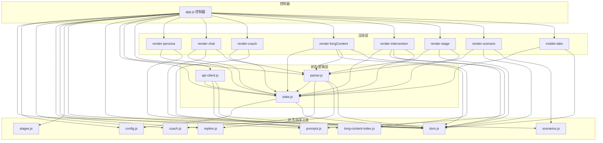
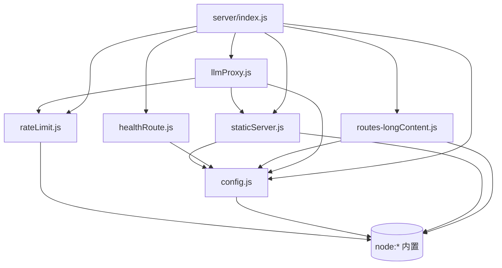
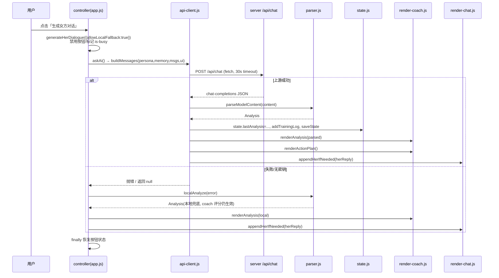
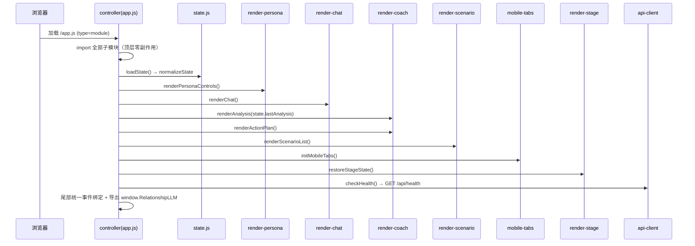

# 设计文档：HeartFlow 恋爱模拟器「前后端完整解耦重构」

- **文档类型**：系统架构设计 + 任务分解（增量，建立在「内容融合 + 智能升级」演进之上）
- **作者**：高见远（软件架构师，software-architect）
- **关联输入**：`docs/PRD-解耦重构.md`、现状 `public/app.js`(2192 行)、`server.js`(405 行)、`public/index.html`、`public/js/*`、`package.json`、`.env.example`、`test/*`、`docs/class-diagram.mermaid`、`docs/sequence-diagram.mermaid`
- **硬约束**：业务行为 100% 不变、现有 63+ 测试全过、原生 ESM 无构建步骤、零新增依赖、循环依赖 = 0、页面无白屏。

---

## 1. 实现方案 + 框架选型

- **框架选型**：沿用现状，**原生 ES Module，无构建步骤、无打包器、无 TypeScript、无框架**。`package.json` 的 `"type": "module"` 保持不变。浏览器通过 `<script type="module">` 直接加载，Node 端用内置 `node:http`/`node:fs`/`node:path`/`node:url` 直接跑。
- **前端装配方式**：`public/app.js` 作为唯一控制器入口（瘦身为 controller），顶部 `import` 下方所有 `public/js/*` 子模块；子模块之间按「叶子 → 共享工具 → 状态/逻辑 → 渲染 → 控制器」单向依赖装配。**模块顶层零副作用**（不读 DOM、不发请求、不改全局），仅导出函数，避免白屏。
- **后端装配方式**：新增 `server/` 目录，`server/index.js` 为装配入口：`createServer` + 按 `pathname` 分发路由（health / chat / long-content / static）。各职责拆为 `server/*.js`，`server/config.js` 在导入时完成 `.env` 加载与常量计算（Node 单次启动，顶层副作用可接受）。
- **零新增依赖**：仅用 Node 内置模块 + 现有依赖。循环依赖检测用**自写零依赖脚本** `scripts/check-circular.mjs`（解析 `import` 行做 DFS），不引入 madge，满足「零新增依赖」硬约束（见 §6、§7）。

---

## 2. 文件清单（精确相对路径 + 单一职责）

### 2.1 前端（入口保持 `public/app.js` 不变）

> 现有已独立叶子模块（**本轮不改动接口**）：`public/js/config.js`、`public/js/coach.js`、`public/js/replies.js`、`public/js/prompts.js`、`public/js/stages.js`、`public/js/scenarios.js`、`public/js/long-content-index.js`、`public/js/dropdown.js`。

| 精确路径 | 职责（单一） |
|---|---|
| `public/app.js` | **控制器 / 装配入口**：`import` 所有子模块；尾部统一事件绑定（`$().addEventListener`）；`window.RelationshipLLM` 原样导出；初始渲染调用。不含内联业务逻辑。 |
| `public/js/dom.js` | 共享 DOM 工具（无状态）：`$`(id)、`escapeHtml`、`getMessageSourceLabel`。**零依赖叶子**。 |
| `public/js/state.js` | 单一可信状态源 + 纯派生：`loadState`/`normalizeState`/`saveState`/`getAllPersonas`/`getCurrentPersona`/`getAvatarSettings`/`clampAvatarPosition`/`defaultMemoryFor`/`getPersonaMemory`/`getConversationWindow`/`buildConversationSummary`/`buildLocalHerReply`(参数化 uiValues)/`normalizeMessages`/`getLatestMineText`/`getState`/`setState`。导入 `config.js`、`dom.js`。 |
| `public/js/parser.js` | 纯解析 + 本地兜底（**必须带走 `localAnalyze` 与教练评分**）：`parseModelContent`/`extractJsonObject`/`normalizeReplyOptions`/`normalizeAnalysis`/`parsePlainTextFallback`/`normalizeCoachScore`/`localAnalyze`/`buildLocalReplyOptions`/`buildLocalRewriteReason`/`parsePreflightEvaluation`/`parseLooseJson`/`parsePlainPreflightEvaluation`/`extractRewriteText`/`parseStageResult`/`parseChapterContent` + 辅助 `pickByRegex`/`extractJsonLikeString`/`extractJsonLikeReplyOptions`/`firstReplyLine`。导入 `coach.js`、`replies.js`、`state.js`、`dom.js`。**不碰 DOM 渲染、不碰网络、不碰 global**。 |
| `public/js/api-client.js` | 网络边界（**不碰 DOM 渲染、不写 state**）：`buildMessages(persona, memory, messages, uiValues)`(纯函数，uiValues={stage,styleBias,goal})、`callLLM({endpoint,apiKey,model,messages,temperature})`、`askAi()` 的网络+解析+写入骨架（编排在 controller）、`checkHealth()`、`getLatestMineText` 由 `state.js` 提供。导入 `state.js`、`prompts.js`、`dom.js`。 |
| `public/js/render-persona.js` | 角色面板/头像：`renderPersonaControls`/`renderMemoryControls`/`savePersonaMemory`/`switchPersona`(跨模块编排可上提到 controller)/`buildCustomPersona`/`saveCustomPersona`/`deleteCurrentPersona`/头像拖拽上传系列。导入 `state.js`、`dom.js`。 |
| `public/js/render-chat.js` | 聊天面板：`renderChat`/`appendMine`/`appendMineIfNew`/`appendHerIfNeeded`/`nextTurn`。导入 `state.js`、`dom.js`、`parser.js`(可选)。 |
| `public/js/render-coach.js` | 教练面板：`renderAnalysis`/`renderTraining`/`renderActionPlan`/`card`/`scoreBar`/`buildSparkline`/`showReviewComparison`。导入 `state.js`、`dom.js`。（若落地 >300 行，再拆 `render-coach-analysis.js`/`render-coach-training.js`/`render-coach-actionPlan.js`，见 §7-Q5。） |
| `public/js/render-longContent.js` | 长篇阅读：`openLongReader`/`closeLongReader`/`renderChapterList`/`renderChapterContent`/`loadChapter`/`saveReadProgress`/`loadReadProgress`。导入 `state.js`、`dom.js`、`parser.js`(parseChapterContent)、`long-content-index.js`。 |
| `public/js/render-intervention.js` | 介入练习模态：`openIntervention`/`closeIntervention`/`buildInterventionContext`/`renderInterventionPanel`/`renderInterventionComparison`/`saveInterventionAsLog`/`submitIntervention`。导入 `state.js`、`dom.js`、`prompts.js`、`parser.js`。 |
| `public/js/render-stage.js` | 阶段判断与同步：`autoDetectStage`/`parseStageResult`(来自 parser)/`applyStageResult`/`onStageManualChange`/`restoreStageState`。导入 `state.js`、`dom.js`、`parser.js`、`prompts.js`。 |
| `public/js/render-scenario.js` | 剧本渲染：`renderScenarioList`/`loadScenario`/`REVIEW_MAPPING`。导入 `state.js`、`dom.js`、`scenarios.js`。 |
| `public/js/mobile-tabs.js` | 移动端 Tab：`initMobileTabs`/`switchTab`/`markCoachUnread`/`clearCoachUnread`。导入 `state.js`、`dom.js`。 |

### 2.2 后端（新增 `server/` 目录）

| 精确路径 | 职责（单一） |
|---|---|
| `server/index.js` | **装配入口**：`createServer` + 路由分发（health/chat/long-content/static）+ `listen` 启动日志。导入下方全部。 |
| `server/config.js` | 路径基准重算 + `.env` 加载 + 常量导出：`loadDotEnv`/`inferApiMode`/`normalizeApiMode`/`maskEndpoint` + `publicDir`/`longSimulationDir`/`envPath`/`PORT`/`LLM_*` 常量（导入即执行 `loadDotEnv`）。导入 `node:fs`、`node:path`、`node:url`。 |
| `server/rateLimit.js` | 每 IP 内存限流：`checkRateLimit`/`rateBuckets`/清理定时器/窗口与上限常量。**零依赖叶子**。 |
| `server/staticServer.js` | 静态服务：`serveStatic`/`readRequestJson`/`sendJson`/`sendText`/`mime` 表。导入 `config.js`、`node:fs`、`node:path`。 |
| `server/healthRoute.js` | `GET /api/health` 响应：`handleHealth`。导入 `config.js`。 |
| `server/routes-longContent.js` | `GET /api/long-content/:chapter` + 章号文件映射 `longContentFiles` + 路径遍历安全。导入 `config.js`、`node:fs/promises`、`node:path`。 |
| `server/llmProxy.js` | `/api/chat` 处理：`handleChat`/`normalizeProxyResponse`/`extractModelContent`/`clamp` 辅助。导入 `config.js`、`rateLimit.js`、`staticServer.js`。 |

> `package.json` 的 `"start"`/`"dev"` 同步改为 `node server/index.js`（见 §7-Q1、任务 T08）。`server.js` 原文件迁移后删除。

---

## 3. 数据结构与接口（类图 / mermaid）

### 3.1 状态结构 `state`（模块级单例，定义在 `state.js`）

```ts
type Message = { type: "me" | "her"; who: string; text: string; source?: string };
type TrainingLogEntry = {
  time: string; stage: string; mine: string; herReply: string;
  source: string; score: CoachScore; baseline: "calibrated";
};
type CoachScore = {
  total: number; naturalness: number; empathy: number;
  boundary: number; momentum: number;
  weakestDim: string; strongestDim: string;
  strength: string; shortcoming: string; nextPractice: string; summary: string;
};
type Analysis = {
  herReply: string; herIntent: string; yourGoal: string; judgement: string;
  risk: string; replyOptions: ReplyOption[]; recommendation: string;
  coachScore: CoachScore;
};

state = {
  personaId: string,                 // "lin"
  customPersonas: Record<string, Persona>,
  personaMemory: Record<string, { background; interests; boundaries }>,
  avatarOverrides: Record<string, { src?; x?; y? }>,
  messages: Message[],
  trainingLog: TrainingLogEntry[],
  lastAnalysis: Analysis | null,
  lastGenerationMeta: { source: string; error: string },
  learning: { schemaVersion; events; dailyTasks; signalAttempts;
              growthSnapshots; replayAnalyses; textbookProgress; settings }
}
```

### 3.2 关键导出函数签名（行为不变，仅搬运/重排）

**state.js**
```js
loadState(): State
normalizeState(next: unknown): State
saveState(): void
getAllPersonas(custom?): Record<string, Persona>
getCurrentPersona(): Persona
getAvatarSettings(persona?): { src; x; y; isOverride }
clampAvatarPosition(value): number
defaultMemoryFor(persona): { background; interests; boundaries }
getPersonaMemory(persona?): { background; interests; boundaries }
getConversationWindow(limit=12): { recent: Message[]; older: Message[] }
buildConversationSummary(messages): string
buildLocalHerReply(persona, memory, latestMine, previousHer, uiValues): string  // uiValues={stage,styleBias}
normalizeMessages(messages): Message[]
getLatestMineText(): string
getState(): State            // structuredClone 快照
setState(next): void         // normalize + save + 触发必要重渲染（在 controller 内接 render）
```

**parser.js（纯函数，可单测；localAnalyze 与教练评分必须完整迁留）**
```js
parseModelContent(content): Analysis
extractJsonObject(raw): string
normalizeReplyOptions(replyOptions): ReplyOption[]
normalizeAnalysis(obj, raw): Analysis
parsePlainTextFallback(raw): Analysis
normalizeCoachScore(input, latestMine, context): CoachScore
localAnalyze(modelError=""): Analysis          // 离线/无密钥兜底，必保留
buildLocalReplyOptions(style, latestMine="", previousHer=""): ReplyOption[]
buildLocalRewriteReason(original, rewrite): string
parsePreflightEvaluation(content, fallbackScore, fallbackFlags, original, fallbackRewrite): {...}
parseLooseJson(raw): any
parsePlainPreflightEvaluation(raw, ...): {...}
extractRewriteText(content, original): string
parseStageResult(content): { stage; reason; confidence; isAuto }
parseChapterContent(rawText, chapterIndex): ChapterUnit[]
// 辅助（导出以便单测）：pickByRegex / extractJsonLikeString / extractJsonLikeReplyOptions / firstReplyLine
```

**api-client.js（网络边界，不碰 DOM/state 写入混合）**
```js
buildMessages(persona, memory, messages, uiValues): { role; content }[]   // uiValues={stage,styleBias,goal}
callLLM({ endpoint, apiKey, model, messages, temperature=1.0 }): Promise<{ raw; content }>
askAi(options?): Promise<Analysis | null>     // 编排：buildMessages→callLLM→parser→写 state→render；silence 控制
checkHealth(): Promise<void>                  // GET /api/health，写 #apiStatus
```
> 说明：`askAi` 内部仍调用 `render*` 与写 `state`（属编排），本阶段保留在 controller 更稳妥；若搬入 api-client，则 api-client 需反向 import render（会破坏分层）。**架构决策：编排逻辑 `askAi`/`generateHerDialogue` 留在 controller（app.js），api-client 只提供 `buildMessages`/`callLLM`/`checkHealth` 等纯边界函数**，由 controller 串起 parser/state/render。

**server/ 关键接口**
```js
// config.js（导入即加载 .env）
loadDotEnv(filePath): void
inferApiMode(endpoint): "responses" | "chat_completions"
normalizeApiMode(value): "responses" | "chat_completions"
maskEndpoint(endpoint): string
export const publicDir, longSimulationDir, envPath, PORT, LLM_ENDPOINT, LLM_MODEL,
  LLM_API_KEY, LLM_API_MODE, LLM_MAX_COMPLETION_TOKENS, LLM_TEMPERATURE, LLM_TOP_P, LLM_REASONING_EFFORT

// rateLimit.js
checkRateLimit(ip): boolean
export const rateBuckets: Map, RATE_LIMIT_WINDOW_MS, RATE_LIMIT_MAX

// staticServer.js
serveStatic(urlPath, res): Promise<void>
readRequestJson(req): Promise<object>
sendJson(res, status, payload): void
sendText(res, status, text): void
export const mime: Record<string,string>

// healthRoute.js
handleHealth(res): void

// routes-longContent.js
handleLongContent(pathname, res): Promise<void>
export const longContentFiles: Record<number, string>

// llmProxy.js
handleChat(req, res): Promise<void>
normalizeProxyResponse(text, contentType): string
extractModelContent(json): string
```

### 3.3 模块依赖图（保证循环依赖 = 0）

分层（上层 import 下层，无反向边）：



后端依赖图（同构 DAG）：



**循环依赖 = 0 的保证**：
1. 所有 `render-*` / `api-client` / `parser` 只 import 比自己「层级更低」的模块，从不 import 控制器或彼此（跨模块编排统一在 controller）。
2. `server/` 模块形成严格 DAG：`rateLimit`/`config` 为根，无模块反向 import `index`，`llmProxy` 只依赖 `config`/`rateLimit`/`staticServer`。
3. 现状叶子模块（`config`/`coach`/`replies`/`prompts`/`stages`/`scenarios`/`long-content-index`）彼此**互不 import**（现有 63 测试已证明），保持。
4. 提供 `scripts/check-circular.mjs`（零依赖，DFS 检测）在 CI/本地强制拦截（见 §7-Q2、任务 T25）。

---

## 4. 程序调用流程（时序图 / mermaid）

### 4.1 主线：「用户点生成女方对话」



> 行为契约：`/api/chat` 请求体字段（`messages`/`model`/`temperature`/`apiKey` 等）、响应 chat-completions 形状、`/api/health`、`/api/long-content/:chapter` 的请求/响应结构、状态码、错误体**逐字节兼容**（实现时直接搬运 `server.js` 逻辑，不改字段名与文案）。

### 4.2 页面加载装配顺序



---

## 5. 任务列表（有序、含依赖，前端/后端分组，标注并行）

> 约定：`[并]` = 可与其它 `[并]` 任务并行；`[前:任务]` = 依赖前置任务完成。所有任务业务行为不变，仅搬运/重排/装配。

### 5.1 后端（可独立于前端启动，与前端叶子创建并行）

- **T01** 新建 `server/config.js`：路径基准重算 + `loadDotEnv` + 常量导出。路径算法见 §7-Q1。`[前:无]` `[并:T02,T09]`
- **T02** 新建 `server/rateLimit.js`：搬运 `checkRateLimit`/`rateBuckets`/清理定时器/常量。`[前:无]` `[并:T01]`
- **T03** 新建 `server/staticServer.js`：搬运 `serveStatic`/`readRequestJson`/`sendJson`/`sendText`/`mime`。`[前:T01]`
- **T04** 新建 `server/healthRoute.js`：搬运 `/api/health` 响应。`[前:T01]`
- **T05** 新建 `server/routes-longContent.js`：搬运 `longContentFiles` 映射 + `handleLongContent` + 路径遍历安全校验。`[前:T01]`
- **T06** 新建 `server/llmProxy.js`：搬运 `handleChat`/`normalizeProxyResponse`/`extractModelContent`/clamp，调用 `checkRateLimit` 与 `staticServer` 工具。`[前:T01,T02,T03]`
- **T07** 新建 `server/index.js`：创建 http server + 路由分发 + `listen` 启动日志。`[前:T01–T06]`
- **T08** 更新 `package.json`：`"start"`/`"dev"` → `node server/index.js`；删除根 `server.js`。`[前:T07]`
- **T19b** 新增 server 冒烟测试 `test/server-smoke.test.mjs`：启动 `server/index.js`，断言 `/api/health` 200、`/api/long-content/1` 返回文本、`/` 返回 index.html、`/api/chat` 无 key 返回 400。`[前:T07,T08]`

### 5.2 前端

- **T09** 新建 `public/js/dom.js`：`$`/`escapeHtml`/`getMessageSourceLabel`。`[前:无]` `[并:T01]`
- **T10** 新建 `public/js/state.js`：搬运 state 相关纯函数；`buildLocalHerReply` 改为接收 `uiValues` 参数（DOM 读取上提到 controller 注入），保持行为。`[前:无]` `[并:T01]`
- **T11** 新建 `public/js/parser.js`：**必须完整迁留** `localAnalyze`、`buildLocalReplyOptions`、`normalizeCoachScore` 等兜底与教练评分逻辑，加上全部 `parse*`/`normalize*`/`extract*`。`[前:T09,T10]`
- **T12** 新建 `public/js/api-client.js`：`buildMessages`(参数化 `uiValues`)/`callLLM`/`checkHealth`（网络边界，不混渲染与 state 写入）。`[前:T09,T10]`
- **T13** 新建 `public/js/render-persona.js`。`[前:T09,T10]` `[并:T14–T20]`
- **T14** 新建 `public/js/render-chat.js`。`[前:T09,T10,T11]`
- **T15** 新建 `public/js/render-coach.js`（若 >300 行再拆 3 子模块，见 §7-Q5）。`[前:T09,T10]`
- **T16** 新建 `public/js/render-longContent.js`。`[前:T09,T10,T11]`
- **T17** 新建 `public/js/render-intervention.js`。`[前:T09,T10]`
- **T18** 新建 `public/js/render-stage.js`。`[前:T09,T10,T11]`
- **T19** 新建 `public/js/render-scenario.js`。`[前:T09,T10]`
- **T20** 新建 `public/js/mobile-tabs.js`。`[前:T09,T10]`
- **T21** 瘦身 `public/app.js` 为 controller：删除内联逻辑，改为 `import` T09–T20 全部子模块；把事件绑定与 `window.RelationshipLLM` 导出、初始渲染调用搬入；`askAi`/`generateHerDialogue` 编排保留在此。`[前:T09–T20]`
- **T22** 更新 `index.html` 的 `?v=` 缓存版本号（如 `20260716-1`），`/app.js` 与 `/js/dropdown.js` 同步 bump；`script src` 仍为 `/app.js`（决策 §7-Q2，不改入口路径）。`[前:T21]`

### 5.3 文档 / 测试 / 校验（可穿插并行）

- **T23** 补 `build:index` 与部署说明：更新 `README.md` + 新增 `docs/部署与构建说明.md`。`[前:无]` `[并]`
- **T24** 新增单元测试：`test/parser.test.mjs`（localAnalyze/normalizeCoachScore/parseModelContent 关键兜底）、`test/import-graph.test.mjs`（所有新模块可被 `import` 且不抛错）、`test/server-smoke.test.mjs`（见 T19b）。`[前:T11,T21,T19b]`
- **T25** 新增 `scripts/check-circular.mjs`（零依赖 DFS 循环检测），接入 `package.json` 的 `test` 前置或独立 `npm run check:circular`。`[前:T21,T07]`
- **T26** 无回归验证（见 §8 步骤）。`[前:全部]`

**前端/后端并行示意**：T01–T08（后端）与 T09–T12（前端叶子/工具）可几乎同时开工；T13–T20 依赖 T09–T11；T21 汇总；T22–T26 收尾。后端不阻塞前端，因 `index.html` 仍指向 `/app.js`，旧 `server.js` 与旧 `app.js` 在各自任务完成前互不影响。

---

## 6. 依赖包列表

- **新增运行时依赖：0**。仅用 Node ≥18 内置模块：`node:http`、`node:fs`、`node:fs/promises`、`node:path`、`node:url`、`node:timers`（限流清理用 `setInterval().unref()`）。
- **新增开发依赖：0（默认）**。循环检测用自写 `scripts/check-circular.mjs`（纯 `node:` + 文件系统解析 `import` 语句，DFS 判环），不引入 madge，严守「零新增依赖」。
- **现有依赖**：`package.json` 仅 `"type":"module"`，无第三方依赖；`build:index` 仍指向 `scripts/build-long-index.mjs`（不改动）。
- 若团队后续坚持用 madge，再将其作为 `devDependency` 加入（非本阶段必须）——本设计默认不新增。

---

## 7. 共享约定

- **命名规范**：函数 `camelCase`；前端渲染模块统一 `render-<domain>.js` 并导出 `render<Domain>*`；后端模块 `lowerCamel` 导出函数 + `UPPER` 常量；配置常量 `LLM_*`/`PORT`。
- **import 风格**：统一相对路径 `./x.js`（浏览器 ESM 必须带扩展名）；不混用绝对路径；`node:` 前缀导入内置模块（如 `node:path`）。
- **state 读写约定**：`state` 作为模块级单例**只定义在 `state.js`**；其它模块通过导入 `state.js` 的函数读写，禁止在各模块内各自维护副本。`setState` 由 controller 在需要时调用（normalize + save + 触发必要重渲染），避免渲染层直接改全局。
- **错误兜底（强制）**：`localAnalyze`、`buildLocalReplyOptions`、`buildLocalRewriteReason`、`normalizeCoachScore` **必须在 `parser.js` 完整保留**，离线/无密钥时 `generateHerDialogue` 回退链路行为不变；任何搬运不得删减兜底分支。
- **事件绑定归属**：统一在 controller（`app.js`）尾部绑定区；`render-*` 模块只暴露函数，原则上不自行 `addEventListener`（渲染时绑定「只作用于自身子树」的内部交互如章节列表项点击，允许留在同模块，但跨模块动作一律回 controller 编排）。
- **模块顶层零副作用**：禁止在模块顶层读 DOM（`document`/`window`）、发网络请求、改全局变量；所有副作用置于被调用的函数体内，杜绝 ESM 导入链白屏。
- **`window.RelationshipLLM`**：原样重新 `export` 同一组方法（`buildMessages`/`call`/`preflightReply`/`getPersonaMemory`/`getState`/`setState`），保留调试接口与外部兼容。
- **缓存版本号**：每次上线 bump `index.html` 的 `?v=`（含 `/app.js` 与 `/js/dropdown.js`），防止浏览器命中旧模块路径缓存。

---

## 8. 对 PRD 7 个开放问题的默认决策（已替用户拍板）

| # | 问题 | 决策 | 理由 |
|---|---|---|---|
| Q1 | 是否新增 `server/` 目录 | **是**。`server.js` → `server/index.js`，根 `server.js` 删除；`package.json` `start`/`dev` → `node server/index.js`。 | 分层清晰、限流/代理/长内容可独立单测、便于后续扩展；根目录更整洁。路径基准用 `path.join(__dirname, "..")` 重算（见下），避免风险。 |
| Q2 | 控制器入口命名 | **保留 `public/app.js`** 作装配入口（内部 `import` 子模块），**不改 `index.html` script src**。 | 避免改 `index.html` 与 `?v=` 联动引发的白屏风险；降低回归面。 |
| Q3 | 是否补 `build:index` 文档 | **是**，更新 `README.md` + 新增 `docs/部署与构建说明.md`。 | 消除 P2-3 盲区，让部署可复现。 |
| Q4 | 是否补单测 | **是**，至少补：server 启动冒烟 + 新模块导入链测试 + parser 关键兜底单测。 | 直接消除控制器/server 回归盲区（P2-1），成本低收益高。 |
| Q5 | 300 行红线是否严格 | **目标 ≤300**；`render-coach` 类允许到 **~400 并显式标注**，确需再拆 `render-coach-analysis`/`render-coach-training`/`render-coach-actionPlan`。 | 纯渲染函数行数天然偏大，硬拆反而增加跨文件调用复杂度；以「逻辑单一、可测」优先于机械行数。 |
| Q6 | 是否保留 `window.RelationshipLLM` | **保留**，原样 `export` 同一组方法。 | PRD 风险项明确其为调试/外部依赖；零成本保留。 |
| Q7 | 拆分范围是否含 SSE | **不含**；仅迁移现有 `stream:false` 路径，不实现 SSE。 | 当前未实现 SSE，行为与契约 100% 保持不变；未来 SSE 归入 `llmProxy`。 |

### Q1 路径基准重算（关键，防 404/读不到 .env）

迁移前 `server.js` 在根目录：`__dirname === <root>`，故 `publicDir = <root>/public`、`longSimulationDir = <root>/long-simulation`、`.env = <root>/.env`。

迁移后 `server/config.js` 在 `<root>/server/`：`__dirname === <root>/server`，必须重算：

```js
const __filename = fileURLToPath(import.meta.url);
const __dirname = path.dirname(__filename);
const ROOT_DIR = path.join(__dirname, "..");          // ← 关键：回到项目根
export const publicDir = path.join(ROOT_DIR, "public");
export const longSimulationDir = path.join(ROOT_DIR, "long-simulation");
export const envPath = path.join(ROOT_DIR, ".env");   // loadDotEnv(envPath)
```

> 选用 `path.join(__dirname, "..")` 而非 `process.cwd()`：无论从哪个工作目录启动（`node server/index.js` 或 `node relationship-simulator/server/index.js`），基准都正确，不依赖 shell 当前目录。

---

## 9. 如何验证「无回归」（具体步骤）

1. **语法 / 导入链校验（节点层，零依赖）**
   ```bash
   for f in public/app.js public/js/*.js server/*.js scripts/*.mjs; do
     node --check "$f" && echo "OK $f" || echo "FAIL $f"
   done
   node scripts/check-circular.mjs     # 自写 DFS，输出 0 环
   ```
2. **循环依赖检测**：`node scripts/check-circular.mjs`（对 `public/js` 与 `server/` 静态解析 `import` 行，DFS 判环；期望输出 `circular: 0`）。
3. **现有测试全过（叶子模块接口稳定）**：`npm test` → 63+ 用例 100% 通过。
4. **新增测试**：`test/parser.test.mjs`（localAnalyze/normalizeCoachScore 行为）、`test/import-graph.test.mjs`（所有新模块 `import` 不抛错）、`test/server-smoke.test.mjs`（启动 `server/index.js` 后 `/api/health`/`/api/long-content/1`/`/` 200、`/api/chat` 无 key 400）。
5. **浏览器加载无白屏（手动 + 冒烟清单）**：
   - `npm start` 启动，浏览器开 `http://localhost:3000`，确认三栏 DOM 渲染完成、`#apiStatus` 有文案、`window.RelationshipLLM` 可用、Console 无报错。
   - 走查：发消息 / 生成女方对话 / 发送前测验 / 教练分析 / A-B-C 回复 / 长期路线 / 阶段自动判断 / 剧本加载 / 长篇阅读 / 介入练习 / 角色切换·自定义·头像 / 移动端 Tab。
   - 断网或无 `LLM_API_KEY` 场景：确认 `localAnalyze` 兜底与教练评分仍正常（关键路径）。
   - 确认 `index.html` 的 `?v=` 已 bump，避免旧缓存。
6. **API 契约逐字节兼容**：对比重构前后 `/api/chat` 请求/响应字段、`/api/health`、`/api/long-content/:chapter` 状态码与错误体，行为一致。

> 成功标准对应 PRD §4：单文件 ≤300（render-coach 允许 ~400 并标注）、循环依赖=0、现有 63+ 测试全过、页面无白屏、API 契约不变、业务行为不变、无构建步骤。
